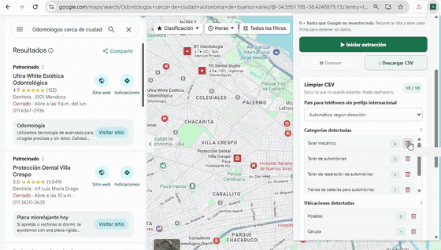
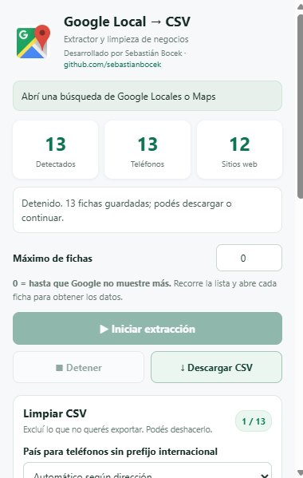

# Google Maps Scraper — Chrome Extension

**Prospección local más simple para freelancers.** Encuentra negocios en Google Maps, revisa y limpia los datos, y expórtalos a CSV desde Chrome.

[Descargar extensión](https://github.com/sebastianbocek/Google-Maps-Scraper---Extension-Chrome/releases/latest/download/google-maps-scraper-extension.zip) · [Ver video de muestra](https://github.com/sebastianbocek/Google-Maps-Scraper---Extension-Chrome/releases/latest/download/demo.mp4)

## Demo

[Ver o descargar el video MP4](assets/demo.mp4)

## Vista de la extensión

## Qué hace

- Extrae fichas de negocios visibles en Google Maps y Google Local.
- Permite escribir una búsqueda en el panel; abre Google Maps en una pestaña nueva e inicia la extracción.
- Incluye un modo de campaña para recorrer en secuencia las ciudades de una o varias provincias argentinas y acumular sus resultados en el mismo CSV.
- Guarda nombre, teléfono, valoración, categoría, sitio web, enlace de WhatsApp y URL de la ficha de Google Maps cuando están disponibles.
- Omite fichas duplicadas durante el recorrido y vuelve a depurar registros guardados antes de exportar; compara el identificador de Google Maps y, si no está disponible, nombre más dirección o teléfono.
- Permite marcar y desmarcar categorías de negocio con casillas antes de exportar. Todas comienzan desmarcadas; hay acciones para seleccionar todas o ninguna y el contador se actualiza al instante.
- Permite iniciar, detener y continuar la extracción desde el panel de la extensión.
- Guarda el progreso por ficha para poder detener o reanudar una extracción, incluso después de cambiar de pestaña o cerrar la pestaña de Maps.
- Incluye un registro de actividad con información de cada scroll, progreso y error, y permite copiarlo para diagnosticar problemas.
- Limpia la exportación antes de descargar: selecciona categorías, excluye ciudades, permite elegir una ubicación objetivo y filtrar negocios con o sin sitio web y teléfono.
- Descarga los resultados como archivo `.csv`, listo para revisar en una hoja de cálculo o importar a un CRM.
- Permite añadir un mensaje opcional prellenado en cada enlace de WhatsApp del CSV; si el campo queda vacío, crea el enlace habitual sin texto.
- En el filtro de sitio web, los perfiles de Instagram y Facebook cuentan como “sin sitio web”; sus enlaces se conservan en el CSV.
- Añade la columna `url_negocio` con el enlace a la ficha de cada negocio en Google Maps.
- Abre WhatsApp Web para un teléfono con `Alt` + clic sobre el número en Google Maps.
- Procesa y guarda los datos localmente en Chrome; no los envía a un servidor externo.

> La cantidad y calidad de resultados dependen de lo que Google Maps cargue y muestre. La herramienta no garantiza que un teléfono tenga WhatsApp ni que cada ficha incluya todos los campos.

## Instalación en Chrome

1. [Descarga la extensión en ZIP](https://github.com/sebastianbocek/Google-Maps-Scraper---Extension-Chrome/releases/latest/download/google-maps-scraper-extension.zip) y descomprímela. El ZIP contiene una carpeta llamada **Google Maps Scraper - Extension Chrome**.
2. Abre `chrome://extensions/` en Chrome.
3. Activa **Modo desarrollador** en la parte superior derecha.
4. Haz clic en **Cargar descomprimida**.
5. Selecciona la carpeta **Google Maps Scraper - Extension Chrome** que contiene `manifest.json`.
6. Abre la extensión, escribe una búsqueda, por ejemplo “cafeterías en Palermo”, y haz clic en **Buscar y comenzar extracción**. Se abrirá Google Maps en una pestaña nueva y la extracción comenzará automáticamente.
7. Puedes cambiar de pestaña mientras se extraen los resultados. Si la extracción se detiene, pulsa **Continuar extracción guardada** para retomar el progreso; si hace falta, la extensión volverá a abrir Maps en segundo plano.
8. Para buscar en varias ciudades, usa **Búsqueda por varias ciudades** debajo del buscador normal. Escribe el rubro, elige Argentina y marca una o más provincias; desmarca una casilla para quitar una provincia. La campaña buscará en cada ciudad de las provincias marcadas, en orden, y acumulará los resultados. Si no marcas ninguna, recorrerá las ciudades cargadas de todas las provincias argentinas, una por una.
9. La campaña avanza automáticamente cuando Maps deja de cargar resultados en una ciudad. Puedes pausarla y continuarla desde la ubicación en curso.
10. También puedes abrir [Google Maps](https://www.google.com/maps), realizar una búsqueda y comenzar la extracción desde el panel.
11. En **Limpiar CSV**, marca las categorías que quieres conservar; puedes seleccionarlas todas o ninguna. Elige también si quieres todos los negocios o solo los que tengan o no tengan sitio web y teléfono. Los perfiles de Instagram y Facebook cuentan como negocios sin sitio web. También puedes excluir ciudades, elegir una ubicación objetivo y definir un mensaje opcional para los enlaces de WhatsApp.
12. Haz clic en **Descargar CSV**.

El contador de fichas exportables se actualiza al cambiar los filtros. La ubicación objetivo aparece como sugerencia, pero no filtra la exportación hasta que actives **Exportar solo la ubicación objetivo**. Así, la descarga normal combina únicamente los filtros que elegiste.

**Límite de fichas:** `0` no establece un máximo. La extensión sigue desplazándose mientras Maps cargue resultados; si no hay avance después de varios intentos, se pausa, guarda el progreso y permite continuar. No equivale a todos los negocios existentes en la zona.

## Cómo ayuda en la prospección freelance

Para freelancers de marketing, diseño web, SEO, fotografía y servicios comerciales, el directorio de negocios puede ser un punto de partida para investigar prospectos locales. La extracción reduce la carga de copiar datos ficha por ficha; la limpieza ayuda a enfocar la lista por rubro y zona, y el CSV facilita organizar la investigación, priorizar contactos y preparar mensajes personalizados.

Usa los datos para investigación y contacto responsable: verifica cada negocio y respeta las leyes aplicables, las condiciones de las plataformas y las preferencias de contacto. La extensión no envía mensajes automáticamente.

## Actualizar la extensión

Si ya tienes una versión instalada, conserva la misma carpeta de instalación: reemplaza sus archivos por los de la nueva versión, vuelve a `chrome://extensions/`, pulsa **Recargar** en la tarjeta de la extensión y actualiza la pestaña de Google Maps. Así Chrome puede conservar la identidad y los datos locales de la instalación.

## Archivos del proyecto

- `manifest.json`: configuración de la extensión Manifest V3.
- `popup.html`, `popup.css`, `popup.js`: panel, controles y limpieza de exportación.
- `content.js`: lectura y extracción de fichas desde Google.
- `data_utils.js`, `quick_whatsapp.js`: utilidades de datos y acceso rápido a WhatsApp.
- `background.js`: servicio en segundo plano y descarga.
- `locations_ar.js`: catálogo de provincias y ciudades para las campañas de Argentina.
- `assets/demo.gif`, `assets/demo.mp4`: muestra animada y video original.

## Privacidad y límites

La extensión no usa un backend y guarda los resultados en el almacenamiento local de Chrome. Google puede cambiar su interfaz, lo que puede afectar la extracción. Los resultados pueden incluir datos incompletos o negocios de localidades cercanas; comprueba la lista antes de contactar o exportar.

## Instalación manual desde el código

Clona este repositorio, abre `chrome://extensions/`, activa **Modo desarrollador** y selecciona **Cargar descomprimida** para la carpeta del proyecto que contiene `manifest.json`.

